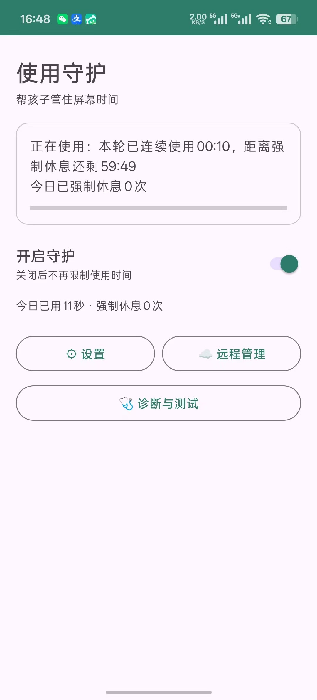
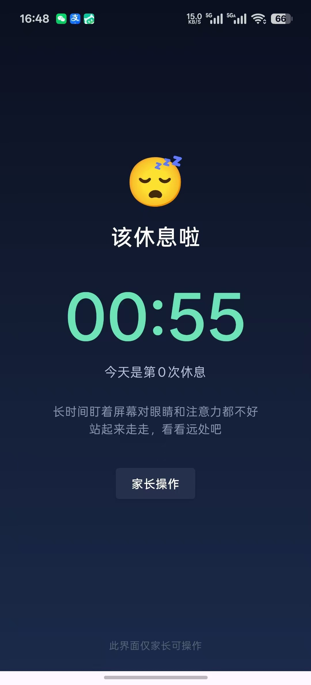
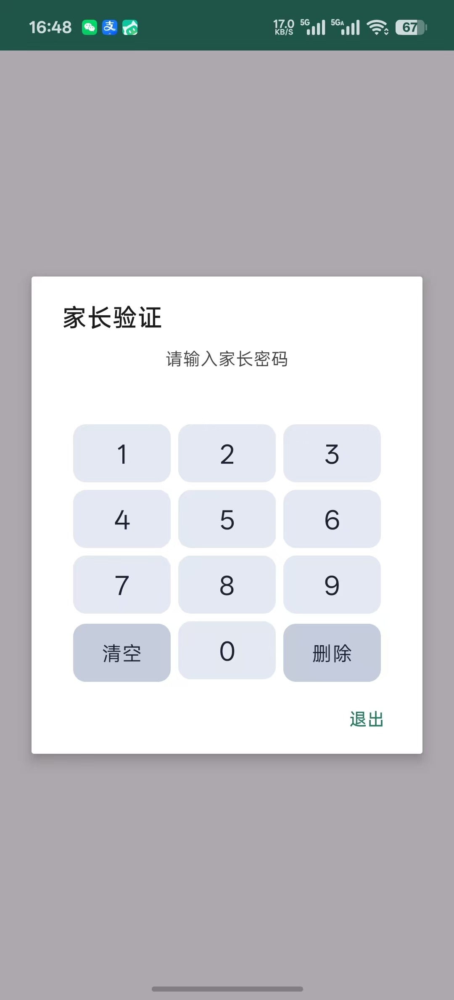
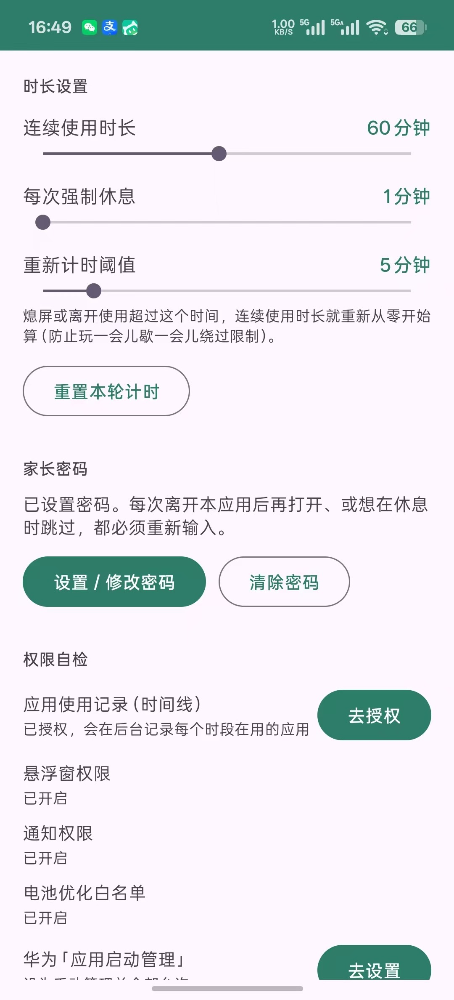
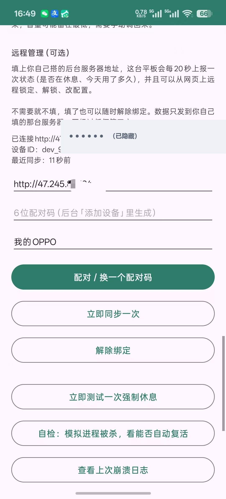
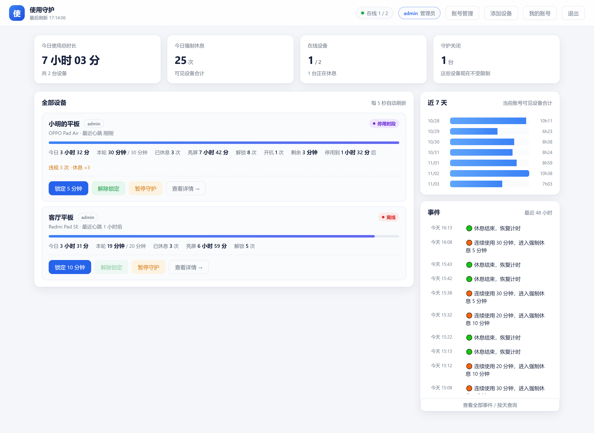
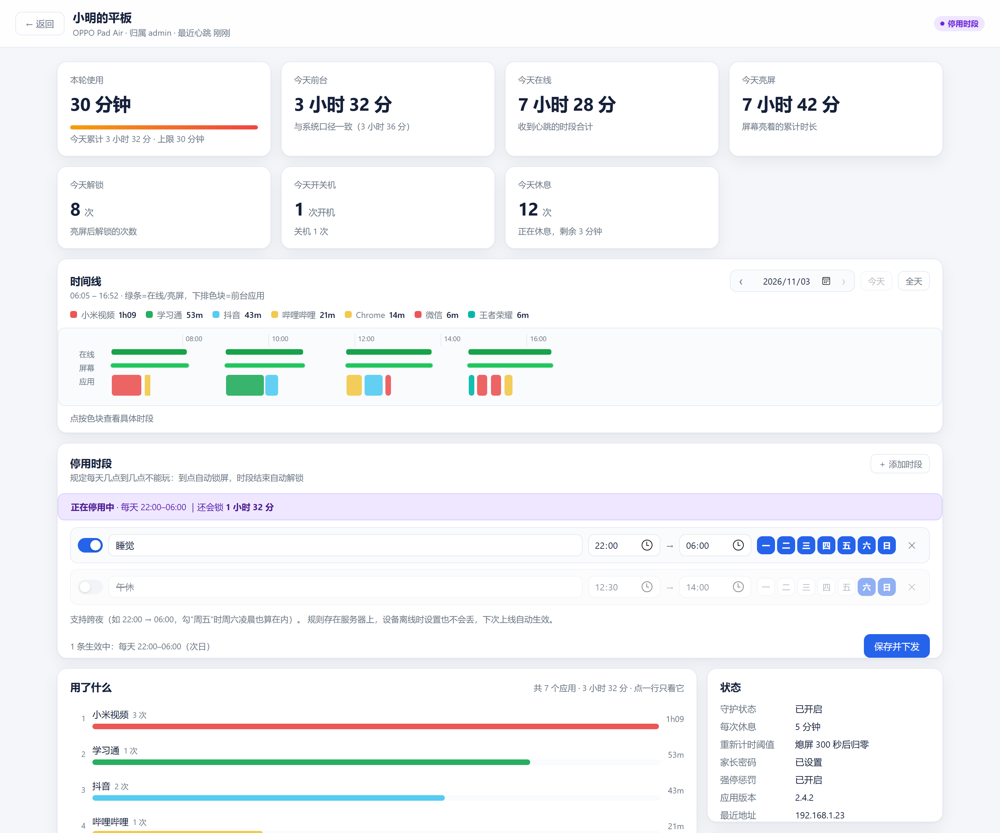

# 使用守护 · Guardian

> 一个爸爸给孩子平板写的防沉迷系统。**到点就锁，锁了就出不去，锁不住就记账。**


-green)


---

## 为什么要做这个

家里孩子的平板，说好「玩 30 分钟休息 5 分钟」，结果一刷就是一下午。试过各种办法：

- **口头约定**：到点收不走，一句「马上就好」能拖半小时；
- **系统自带的屏幕使用时间 / 家长控制**：孩子知道密码就能改，或者直接把应用从后台划掉；
- **第三方限时 App**：卸载、强行停止、清数据、改系统时间，总有一种办法绕过去；
- **人不在家**：想临时锁一下、想看看今天到底玩了多久，都做不到。

所以自己写了一套：**规则写在云端，执行落在本机，孩子端没有能改规则的入口**。
被强行停止也别想白玩——欠的休息会记下来，下次打开时连本带利兑现。

它不是监控聊天内容的工具，只回答三个问题：**用了多久、什么时候该停、有没有被绕过**。

## 适用场景

| 场景 | 它怎么工作 |
| --- | --- |
| 写作业时平板放着，怕孩子偷偷刷视频 | 连续使用到上限，全屏遮罩强制休息，返回键 / Home 键都出不去 |
| 晚上 22 点之后不许玩 | 云端配置「停用时段」，到点自动锁屏，时段结束自动解锁 |
| 家长不在家，想临时锁一下 | 打开网页后台，点一下「锁定 5 分钟」，下一个 20 秒心跳就下发 |
| 想知道「今天到底玩了多久、都玩了什么」 | 后台时间线按小时展示亮屏区间与前台应用，可点某个应用只看它 |
| 孩子把进程划掉 / 强行停止 | 系统闹钟到点自检 + 惩罚欠账，重开 App 时补上休息，且次数越多休息越久 |
| 想让孩子「用一会儿就得动脑」 | 每用满 N 分钟弹一道小题（语文拼音 / 20 以内加减 / 牛津树单词），答对才能继续 |

---

## 功能

### 平板端（Android App）

- **强制休息**：本轮连续使用达到设定时长，弹出全屏遮罩；倒计时结束前无法退出。
- **每日总时长**：一天累计使用达到上限（如 90 分钟）就锁到次日 0 点，**不会自己解除**；家长可用密码临时放行 15 分钟，或在后台点「今日解除」。
- **答题解锁（v2.6.0）**：每用满 N 分钟（默认 10）弹一道小题，答对就继续；不会做可以「换一题」，
  两道都没答对就休息 P 分钟（默认 2）后自动解锁。题库从服务端下载并缓存，科目为语文 / 数学 / 英语，
  支持选择题与「补全单词」（自绘 26 键字母盘，不依赖输入法）；没配服务端时用本地生成的 20 以内加减法兜底。
- **休息时安静**：申请音频焦点让正在播放的视频暂停；可选通知使用权下发暂停。
- **家长密码**：设置页、跳过休息、提前结束停用都要过密码；密码门禁绑在主界面生命周期里。
- **停用时段（宵禁）**：每天固定钟点锁屏，支持跨夜（如 22:00–06:00）与按星期生效；规则只认服务端下发，本机没有编辑入口。
- **防绕过**：前台常驻服务 + 开机自启 + 每 15 秒系统闹钟自检 + 设备管理员；被强行停止后记录惩罚欠账（1 次 ×1、2 次 ×2、3 次起 ×3）。
- **幂等计时**：使用时长从系统使用事件「整天重扫」得到，不依赖进程存活；OPPO 速冻、Doze、杀后台都不会让时间凭空消失或翻倍。
- **扣掉被锁的时间**：遮罩是悬浮窗，系统仍把时间记给微信/抖音，所以要把「被锁着干等」的区间从使用时长里扣掉。

### 管理后台（Rust + axum）

- 单个**静态二进制**，SQLite 编进二进制，前端页面 `include_str!` 编进去——服务器上什么都不用装。
- 设备列表 / 全屏设备主页：本轮使用、今天前台、亮屏、解锁与开关机次数、休息次数。
- **时间线**：按天查看在线 / 亮屏 / 前台应用色块，点某个应用只看该应用，点空白恢复全部。
- **远程指令**：锁定、解除锁定、暂停守护、改时长配置（含每日总时长与答题解锁参数）、清零违规计数、提前结束本次停用、今日解除 / 恢复每日限制。
- **题库管理（v2.6.0）**：新建题库、逐题增删改、按「题干|选项|选项|答案」或「S|题干|模板|答案|提示」批量导入（也吃整段 JSON），
  设备页勾选要用的题库；题库内容一变版本号就变，设备下一次心跳自动重下。
- **多账号**：PBKDF2 口令哈希，设备归属锚定配对码，越权返回 404。
- **JSON → SQLite 自动迁移**：老版本升级不用手敲命令。

---

## 架构

```
   平板 / Android                          家长浏览器
   ┌──────────────────────┐              ┌──────────────────┐
   │ GuardianService      │   20s 心跳   │  管理后台 SPA     │
   │  · 使用事件重扫       │ ───────────▶ │  (HTML/CSS/JS)   │
   │  · 休息 / 停用判定    │              └────────┬─────────┘
   │  · 全屏遮罩 + PinPad │ ◀───────────          │
   │  · setAlarmClock 自检│   指令 / 配置          │
   └──────────┬───────────┘              ┌────────▼─────────┐
              │                          │ guardian-server  │
              │ UsageStats / AlarmManager│  Rust + axum     │
              ▼                          │  SQLite 单文件   │
       Android 系统事件                  │  静态二进制      │
                                        └──────────────────┘
```

- **App 不依赖网络也能管时间**：断网时按本机已有配置继续强制休息；联网后补传状态。
- **规则以服务端为准**：停用时段、时长配置由心跳每轮带全量下发，设备上报的同类字段服务端不采信。
- **时间口径**：`from/to` 用设备本地当天 0 点起算的毫秒；统计按设备本地 `day` 归集，跨时区不错天。

更多设计取舍见 [`docs/ARCHITECTURE.md`](docs/ARCHITECTURE.md)，部署步骤见 [`docs/DEPLOY.md`](docs/DEPLOY.md)。

---

## 截图

### 平板端

| 主界面 | 到点强制休息 | 家长验证 |
| --- | --- | --- |
|  |  |  |

| 时长设置 | 休息时的家长操作 | 远程管理 |
| --- | --- | --- |
|  |  |  |

### 管理后台

| 首页总览 | 设备详情页 |
| --- | --- |
|  |  |

> 后台截图为 `preview/mock-server.js` 的确定性演示数据，不含任何真实设备信息。

---

## 快速开始

### 1. 装 App

从 [Releases](https://github.com/yangguichun/usage-guardian/releases) 下载 `使用守护-v2.6.0-release.apk`，安装到平板。
首次打开按要求授予：**使用情况访问、悬浮窗、通知、自启动、电池优化白名单**，并激活设备管理员。

在设置页填服务端地址完成配对；**不配对时一个请求都不会发出**。

### 2. 起服务端

```bash
# 有现成二进制（推荐）
tar xzf guardian-server-2.6.0-linux-x86_64.tar.gz
cd guardian-server
GUARDIAN_ADMIN_PASSWORD='换成你自己的强口令' ./run.sh

# 或者从源码交叉编译（详见 GuardianServer/README.md）
cd GuardianServer && bash build.sh
```

浏览器打开 `http://<服务器>:8000`。

> ⚠️ **服务端不内置 TLS，端口是明文 HTTP。** 公网部署请务必套一层 HTTPS 反向代理，
> 并用防火墙限制 8000 端口只对本机/内网开放。默认口令 `guardian2026` 必须在启动前换掉。

### 3. 配规则

后台「停用时段」里加一条，例如「每天 22:00 → 06:00」，保存并下发；下一轮心跳生效。
App 端不提供停用规则的编辑入口，避免孩子自己改。

---

## 从源码构建

| 组件 | 要求 | 命令 |
| --- | --- | --- |
| Android App | JDK 17、Android SDK 34、Gradle 8.7 | `cd Guardian && ./gradlew assembleRelease --max-workers=1 -x lintVital*` |
| 服务端 | Rust stable、zig（交叉编译 C 用） | `cd GuardianServer && bash build.sh` |
| 前端自检 | Node.js | `cd GuardianServer && node preview/ui-check.js` |
| 接口自检 | Python 3 | `cd GuardianServer && python test_api.py` |

各子项目的详细构建说明见 [`Guardian/README.md`](Guardian/README.md) 与 [`GuardianServer/README.md`](GuardianServer/README.md)。

---

## 目录

```
Guardian/            Android App（Kotlin，minSdk 26）
  app/src/main/      GuardianService / Quiet / Usage / Prefs / KeepAlive / LockActivity …
  dist/              构建产物（不进 git）
GuardianServer/      Rust 管理后台（axum + rusqlite）
  src/               main / handlers / store / db / util
  static/            前端 SPA（编进二进制）
  preview/           前端预览桩服务 + 92 条布局自检
  deploy/            一键部署脚本（deploy.env 含口令，不进 git）
  test_api.py        231 条接口断言
docs/                架构说明与部署文档
screenshots/         演示截图
```

---

## 隐私与安全

- 只采集**使用事件的类别与时间戳**（前台应用包名、亮灭屏、开关机），不采集内容、不上传聊天与浏览记录。
- 截图与演示数据均为脱敏内容；仓库内**不含**任何真实服务器地址、SSH 口令或设备标识。
- `deploy/deploy.env` 含真实凭据，已在 `.gitignore` 中排除；请使用 [`deploy.env.example`](GuardianServer/deploy/deploy.env.example) 填写自己的配置。
- 本项目是家庭自用的管控工具，请仅在自己拥有管理权的设备上使用，并让孩子知情。

## 已知限制

- 设备被「强行停止」后，Android 会清空该应用的全部闹钟与广播，没有任何代码会被执行；只能等下次打开 App 时兑现惩罚欠账。**这不是 bug，是系统行为。**
- 关机次数依赖 ROM 是否记录 `DEVICE_SHUTDOWN` 事件，部分 OPPO ROM 不记录。
- App 用 debug 签名以便直接安装，生产使用请换成自己的签名密钥。

---

## 版本

当前 **v2.6.0**（App versionCode 24 / 服务端 2.6.0）。变更记录见 [Releases](https://github.com/yangguichun/usage-guardian/releases)。

## 许可

[MIT](LICENSE)
